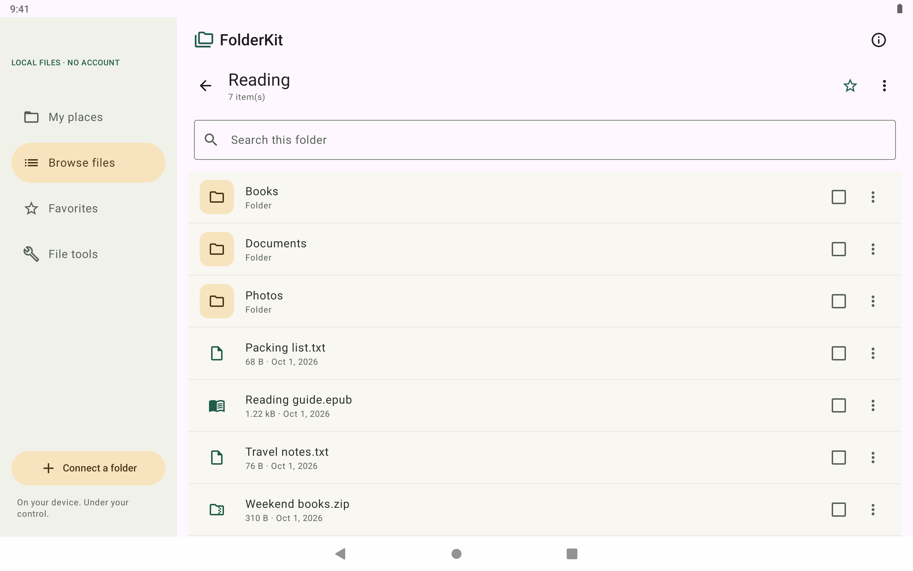
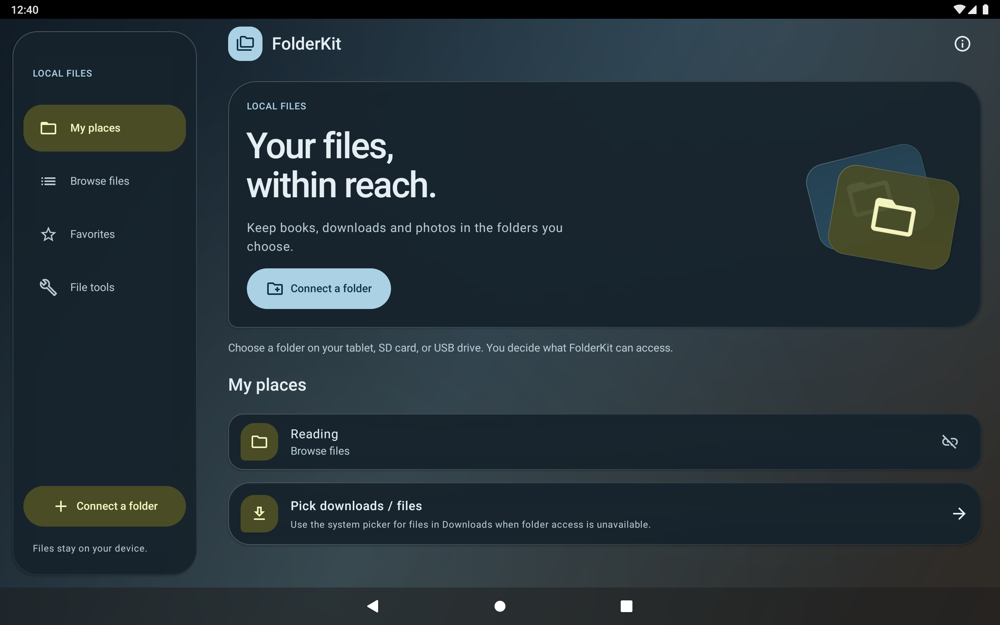
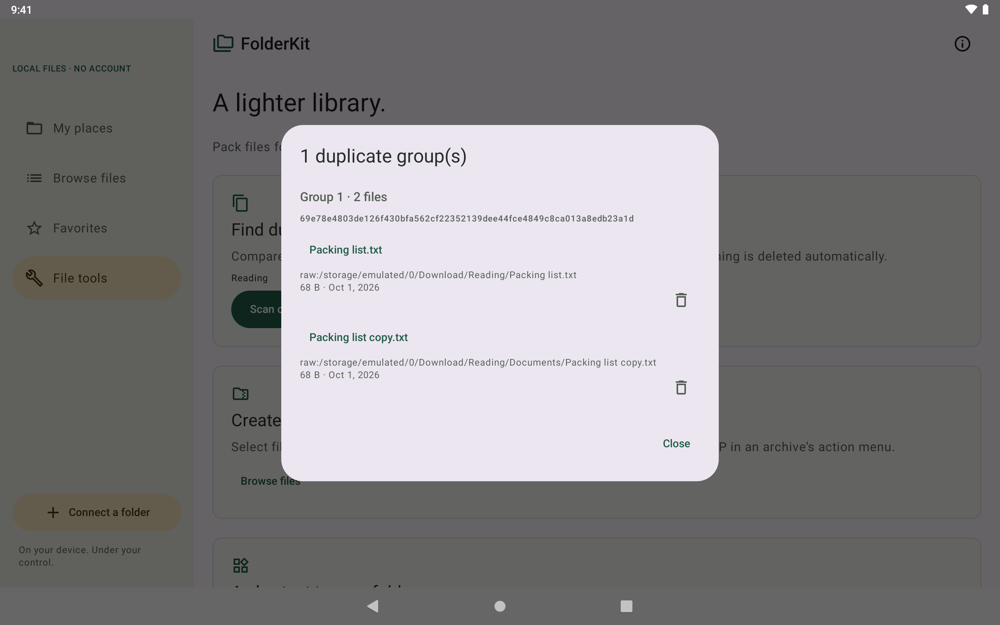

# FolderKit for Fire tablets

A local file manager for Fire tablets. Kotlin + Jetpack Compose, built independently using Android's Storage Access Framework (SAF) and AndroidX DocumentFile.

[](https://github.com/guardyanz/kindlefiles-plus/actions/workflows/android.yml)
[](LICENSE)
[](https://github.com/guardyanz/kindlefiles-plus/releases/tag/v0.9.0-rc2)

**Public beta: 0.9.0-rc2.** No backend, accounts, ads, analytics, Google Play Services or internet permission. The source repository keeps its original `kindlefiles-plus` URL. Physical Fire tablet validation is still pending; this is not an Amazon Appstore release.

**[Download the signed APK](https://github.com/guardyanz/kindlefiles-plus/releases/download/v0.9.0-rc2/folderkit-0.9.0-rc2.apk)** · **[Watch the interaction demo](https://github.com/guardyanz/kindlefiles-plus/releases/download/v0.9.0-rc2/folderkit-motion.mp4)** · [Report a bug](https://github.com/guardyanz/kindlefiles-plus/issues/new?template=bug_report.yml)



<p>
  
  
</p>

These are captures of the signed app on an AOSP emulator, with disposable sample files. See the [screenshot provenance](store-assets/screenshots/README.md) and [UI verification](store-assets/verification/README.md); they do not establish compatibility with physical Fire OS storage providers.

## Try the beta

1. Download the APK above on an Android 9+ device or Fire tablet running Fire OS 7+.
2. Allow installation from your chosen browser or file app when Android asks, then install FolderKit.
3. Choose **Connect a folder**, grant access to a disposable test folder, and try browsing, copying, ZIP tools and duplicate review.

For a first run, use copies of files you can replace. Read [storage behavior and limits](#storage-behavior-and-limits) before moving or deleting files. Release assets include SHA-256 checksums. Existing Kindle e-ink devices are not supported.

## What works

- Connect user-selected folders on internal storage, SD cards and USB volumes exposed by the system picker; persist folder access.
- Browse, current-folder search, name/date/size sorting, hidden-file toggle, metadata, folder creation and rename.
- Multi-select files or folders; copy or move between selected folders. SHA-256 read-back verifies file contents before a move deletes its source. Name collisions are refused.
- Pick individual downloads when Android will not grant access to the entire Downloads directory.
- Create ZIP archives from selected files or folders; extract nested ZIP archives into a new folder. Traversal paths, duplicate entries, excessive nesting, more than 10,000 entries and expansion over 2 GiB are rejected.
- Scan a folder and subfolders for SHA-256 duplicates; review and confirm each deletion. Nothing is deleted automatically.
- Persist folder favorites. Sampled image preview and native video playback. Open PDF/EPUB with a compatible installed reader.
- Share files using Android's chooser. Choose Kindle if the installed Kindle app offers a compatible share target; no private Amazon API or automatic library upload.
- Configurable folder widget on launchers that support Android widgets.
- Material 3 Expressive theme, tinted glass panels, floating compact navigation, press and selection feedback, and light/dark palettes. Motion follows Android's animation setting. Original launcher vector and Apache-licensed Material icons.

The [rc2 beta release](https://github.com/guardyanz/kindlefiles-plus/releases/tag/v0.9.0-rc2) supplies the signed APK, seven tablet screenshots and an interaction video. [UI verification captures](store-assets/verification/README.md) cover dark mode, compact portrait and 200% text.

## Build

Requirements: JDK 17 or newer (tested with Android Studio JBR 21), Android SDK platform 36 and build tools 35, and an SDK path in `local.properties` or `ANDROID_HOME`.

```sh
./gradlew :core:test :app:testDebugUnitTest :app:lintDebug :app:assembleDebug
```

Windows PowerShell:

```powershell
$env:JAVA_HOME = '<path-to-your-JDK-17-or-newer>'
$env:ANDROID_HOME = '<path-to-your-Android-SDK>'
.\gradlew.bat :core:test :app:testDebugUnitTest :app:lintDebug :app:assembleDebug
```

Debug APK: `app/build/outputs/apk/debug/app-debug.apk`.
Install using `adb install -r app/build/outputs/apk/debug/app-debug.apk`.
To create a local signing key once and build a verified, signed release candidate on Windows:

```powershell
.\scripts\New-ReleaseKey.ps1
.\scripts\Build-Release.ps1
```

The APK appears in ignored `dist/`; key and password are in ignored `release-secrets/`. Back up both outside this computer before any store submission. Never commit signing secrets. See the [Appstore submission pack](docs/APPSTORE.md).

Pinned baseline: AGP 8.13.2, Gradle 8.13, Kotlin 2.2.10, Compose BOM 2025.11.01, Material 3 1.5.0-alpha09, AndroidX DocumentFile 1.1.0. Expressive APIs require the pinned Material prerelease; the remaining Compose modules use the stable BOM. Minimum API 28 (Fire OS 7/Android 9); target API 35. Review Amazon's requirements again before submission.

## Storage behavior and limits

Access is scoped to what the user grants through SAF. This app cannot browse every path on a tablet. Android 11 restricts root volumes, the Downloads tree, `Android/data` and `Android/obb`. Use **Pick downloads / files** for individual downloads. A USB drive must be mounted and exposed by the device's document provider; there is no raw USB driver.

Transfer and ZIP creation operate on selected files and folders, with a 10,000-item/32-level tree bound. Encrypted, split and ZIP64 archives are unsupported. Search filters the current folder; duplicate scans recurse with the same bound. Some providers report unknown sizes or stale metadata; real Fire hardware testing remains necessary.

Keep the app open during a long operation. Rotation is supported by the ViewModel, but jobs do not resume after process death, force stop, or power loss. Cooperative cancellation removes the current partial output when the provider permits it; completed batch items remain completed. After abrupt process death, inspect the destination for partial output before retrying. Provider failures are shown; no silent overwrites. As with other provider-based operations, a concurrent edit in another app cannot be made atomic with source deletion.

Disconnect removes a saved place, retaining grants potentially used by favorites or widgets. Revoke all app access by clearing its data or uninstalling. Deletion is permanent and requires confirmation.

## Project map

```text
app/   Compose UI, ViewModel, SAF adapter, favorites and folder widget
core/  Provider-neutral streaming file engine and safety regression tests
docs/  Design, release plan, device test matrix, privacy and licensing notes
```

See [design decisions](docs/DESIGN.md), [Appstore submission pack](docs/APPSTORE.md), [release roadmap](docs/ROADMAP.md), [test results and device matrix](docs/TESTING.md), [privacy](docs/PRIVACY.md) and [third-party notices](NOTICE).

## Contribute

Start with [CONTRIBUTING.md](CONTRIBUTING.md). Useful contributions include real Fire tablet compatibility reports, document-provider regression cases, accessibility improvements and translations. Describe the device, OS version and storage provider in a bug report; never attach personal files or signing keys.

## Licensing and provenance

New code and original assets: **Apache-2.0**, copyright 2026 Ribnik Studio. See [LICENSE](LICENSE). Amaze and Material Files are UX references only; their source, assets, screenshots and GPL components were not copied or forked. AndroidX, Kotlin and Material icons supply the implementation foundation. See [dependency notes](docs/DEPENDENCIES.md).

FolderKit is an independent project. This app was not created or endorsed by Amazon. Kindle and Fire are Amazon trademarks.

## Primary platform references

- [Android Storage Access Framework and access restrictions](https://developer.android.com/training/data-storage/shared/documents-files)
- [AndroidX DocumentFile](https://developer.android.com/jetpack/androidx/releases/documentfile)
- [Fire OS 8 for Fire tablets](https://developer.amazon.com/docs/fire-tablets/fire-os-8.html)
- [Amazon Send to Kindle](https://www.amazon.com/sendtokindle)
- [AGP 8.13 release notes and compatibility](https://developer.android.com/build/releases/agp-8-13-0-release-notes)
